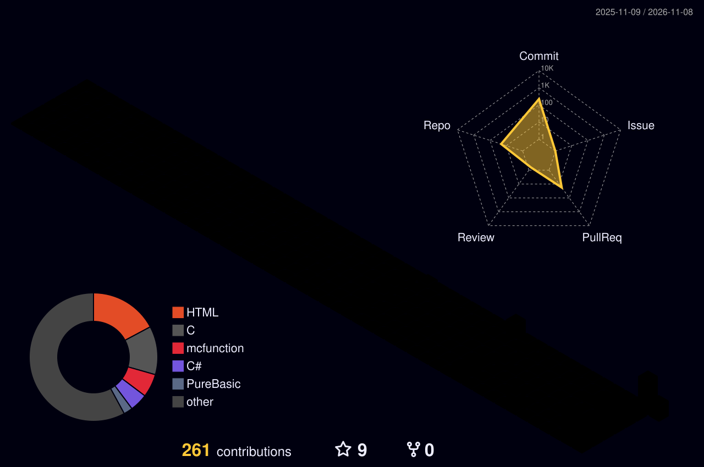

## $Welcome! Here is YJL_SAMA 🌠
- 14岁,事学生
- 14-year-old student

### $my blog
- https://yaojiale7067.github.io/
- https://yaojiale7067blog.pages.dev/

### GitHub Stats
<picture>
  <source media="(prefers-color-scheme: dark)" srcset="https://github-readme-stats-fast.vercel.app/api/top-langs/?username=yaojiale7067&theme=github_dark&layout=compact">
  <source media="(prefers-color-scheme: light)" srcset="https://github-readme-stats-fast.vercel.app/api/top-langs/?username=yaojiale7067&theme=default&layout=compact">
  
</picture>

<picture>
  <source media="(prefers-color-scheme: dark)" srcset="https://github-stats-extended.vercel.app/api?username=yaojiale7067&show_icons=true&theme=github_dark&hide_border=true&count_private=true" alt="My GitHub Stats">
  <source media="(prefers-color-scheme: light)" srcset="https://github-stats-extended.vercel.app/api?username=yaojiale7067&show_icons=true&theme=buefy&hide_border=true&count_private=true" alt="My GitHub Stats">
  
</picture>

  
  
  

- Use **Arch Linux** and **Windows11** on my own PC and **Debian** on servers.
- Use **Hyprland** as desktop environment.

###  🖥️ Github Activity
<h2>
    

  
    

</h2>

<h3>visitor count：</h3>

